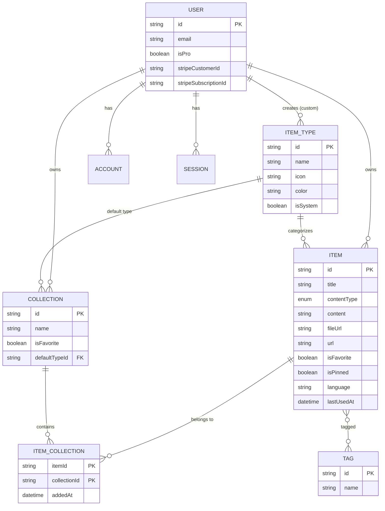
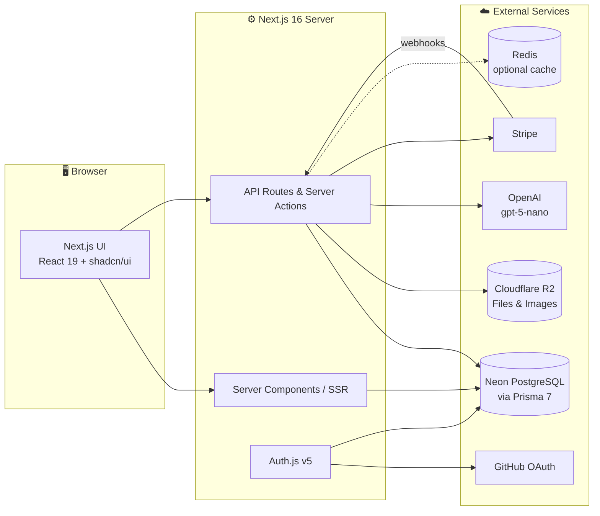
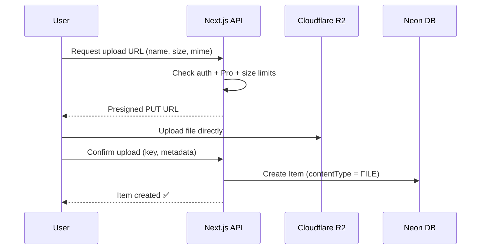

# 🗂️ DevStash — Project Overview

> **One fast, searchable, AI-enhanced hub for all your developer knowledge & resources.**

---

## 📌 Table of Contents

1. [Problem](#-problem)
2. [Target Users](#-target-users)
3. [Features](#-features)
4. [Data Model](#-data-model)
5. [Prisma Schema](#-prisma-schema)
6. [Tech Stack](#-tech-stack)
7. [Architecture](#-architecture)
8. [Routes & API](#-routes--api)
9. [Monetization](#-monetization)
10. [UI / UX](#-ui--ux)
11. [Development Rules](#-development-rules)
12. [Open Questions](#-open-questions)
13. [Reference Links](#-reference-links)

---

## ❗ Problem

Developers keep their essentials scattered across many tools:

| Resource | Where it usually lives |
| --- | --- |
| Code snippets | VS Code, Notion |
| AI prompts | Buried in chat histories |
| Context files | Deep inside project folders |
| Useful links | Browser bookmarks |
| Docs | Random folders |
| Commands | `.txt` files |
| Project templates | GitHub Gists |
| Terminal commands | Bash history |

**Result:** context switching, lost knowledge, and inconsistent workflows.

**DevStash** solves this with a single, fast, searchable, AI-enhanced hub.

---

## 👥 Target Users

| Persona | Primary Need |
| --- | --- |
| 🧑‍💻 **Everyday Developer** | Quickly grab snippets, prompts, commands, and links |
| 🤖 **AI-first Developer** | Save prompts, contexts, workflows, and system messages |
| 🎓 **Content Creator / Educator** | Store code blocks, explanations, and course notes |
| 🏗️ **Full-stack Builder** | Collect patterns, boilerplates, and API examples |

---

## ✨ Features

### A. Items & Item Types

Every piece of saved content is an **Item**, and every item has a **Type**. DevStash ships with **system types** (immutable). User-defined **custom types** come later (Pro).

| Type | Content Kind | Icon (Lucide) | Color | Plan |
| --- | --- | --- | --- | --- |
| Snippet | `TEXT` | `Code` |  `#3b82f6` | Free |
| Prompt | `TEXT` | `Sparkles` |  `#8b5cf6` | Free |
| Note | `TEXT` | `StickyNote` |  `#fde047` | Free |
| Command | `TEXT` | `Terminal` |  `#f97316` | Free |
| Link | `URL` | `Link` |  `#10b981` | Free |
| File | `FILE` | `File` |  `#6b7280` | ⭐ Pro |
| Image | `FILE` | `Image` |  `#ec4899` | ⭐ Pro |

- Type routes use the plural slug: `/items/snippets`, `/items/prompts`, `/items/links`, …
- Items are created and viewed in a **quick-access drawer** (no full page navigation).

### B. Collections

- Users group items into **Collections**, which can hold items of **any type**.
- Items ↔ Collections is **many-to-many** — e.g. a React snippet can live in both *React Patterns* and *Interview Prep*.

Examples:

| Collection | Typical contents |
| --- | --- |
| React Patterns | Snippets, Notes |
| Context Files | Files |
| Python Snippets | Snippets |
| Prototype Prompts | Prompts |

### C. Search

Fast, unified search across:

- ✅ Content
- ✅ Titles
- ✅ Tags
- ✅ Types

> Start with Postgres full-text search (`tsvector` + GIN index) or `pg_trgm` for fuzzy matching; upgrade later if needed.

### D. Authentication

- Email / password (credentials)
- GitHub OAuth

### E. Core Features

- ⭐ Favorite collections and items
- 📌 Pin items to top
- 🕒 Recently used items
- 📥 Import code from a file
- 📝 Markdown editor for text types
- 📤 File upload for file types (File / Image)
- 💾 Export data in multiple formats (JSON / ZIP)
- 🌙 Dark mode by default
- 🔗 Add/remove items to/from multiple collections
- 👀 View which collections an item belongs to

### F. AI Features (⭐ Pro)

| Feature | Description |
| --- | --- |
| 🏷️ Auto-tag suggestions | Suggest tags based on item content |
| 📄 AI Summaries | Short summaries of notes, docs, files |
| 🧠 Explain This Code | Plain-English explanation of a snippet/command |
| ⚡ Prompt Optimizer | Rewrites prompts for clarity and effectiveness |

Model: **OpenAI `gpt-5-nano`**

---

## 🧩 Data Model

### Entity Relationship Diagram



### Model Notes

| Model | Notes |
| --- | --- |
| **User** | Extends the Auth.js (NextAuth v5) user model. Adds `isPro`, `stripeCustomerId`, `stripeSubscriptionId`. |
| **Item** | `contentType` is `TEXT`, `URL`, or `FILE`. Only the matching fields are populated (`content` / `url` / `fileUrl`+`fileName`+`fileSize`). `language` is optional (for syntax highlighting). |
| **ItemType** | `userId` is `null` for system types. `isSystem = true` types cannot be edited or deleted. |
| **Collection** | `defaultTypeId` determines the color/type shown for empty collections. |
| **ItemCollection** | Explicit join table with `addedAt` timestamp. |
| **Tag** | Scoped per user (`@@unique([userId, name])`) so tags don't leak across accounts. |

> **Cleanup notes vs. original draft:**
> - `contentType` expanded from `text | file` to `TEXT | URL | FILE` to match the three type categories.
> - Added `lastUsedAt` on Item to power **Recently used**.
> - Added `userId` to Tag (tags are per-user).
> - Added Auth.js tables (`Account`, `Session`, `VerificationToken`) and `password` for credentials login.

---

## 🛢️ Prisma Schema

> Prisma 7 notes: uses the new `prisma-client` generator with an explicit `output`, the connection URL lives in `prisma.config.ts`, and the Neon **driver adapter** (`@prisma/adapter-neon`) is used at runtime. Verify against the latest Prisma 7 docs before implementing.

```prisma
// prisma/schema.prisma

generator client {
  provider = "prisma-client"
  output   = "../src/generated/prisma"
}

datasource db {
  provider = "postgresql"
}

// ─────────────────────────────────────────────
// Enums
// ─────────────────────────────────────────────

enum ContentType {
  TEXT
  URL
  FILE
}

// ─────────────────────────────────────────────
// Auth (Auth.js / NextAuth v5)
// ─────────────────────────────────────────────

model User {
  id                   String    @id @default(cuid())
  name                 String?
  email                String    @unique
  emailVerified        DateTime?
  image                String?
  password             String?   // hashed (bcrypt/argon2); null for OAuth-only users

  // Billing
  isPro                Boolean   @default(false)
  stripeCustomerId     String?   @unique
  stripeSubscriptionId String?   @unique

  accounts    Account[]
  sessions    Session[]
  items       Item[]
  itemTypes   ItemType[]
  collections Collection[]
  tags        Tag[]

  createdAt DateTime @default(now())
  updatedAt DateTime @updatedAt
}

model Account {
  userId            String
  type              String
  provider          String
  providerAccountId String
  refresh_token     String?
  access_token      String?
  expires_at        Int?
  token_type        String?
  scope             String?
  id_token          String?
  session_state     String?

  user User @relation(fields: [userId], references: [id], onDelete: Cascade)

  createdAt DateTime @default(now())
  updatedAt DateTime @updatedAt

  @@id([provider, providerAccountId])
}

model Session {
  sessionToken String   @unique
  userId       String
  expires      DateTime
  user         User     @relation(fields: [userId], references: [id], onDelete: Cascade)

  createdAt DateTime @default(now())
  updatedAt DateTime @updatedAt
}

model VerificationToken {
  identifier String
  token      String
  expires    DateTime

  @@id([identifier, token])
}

// ─────────────────────────────────────────────
// Core Domain
// ─────────────────────────────────────────────

model ItemType {
  id       String  @id @default(cuid())
  name     String  // "snippet", "prompt", ...
  slug     String  // "snippets", "prompts" (used in /items/[slug])
  icon     String  // Lucide icon name, e.g. "Code"
  color    String  // hex, e.g. "#3b82f6"
  isSystem Boolean @default(false)

  userId String? // null for system types
  user   User?   @relation(fields: [userId], references: [id], onDelete: Cascade)

  items              Item[]
  defaultCollections Collection[]

  @@unique([userId, slug])
  @@index([userId])
}

model Item {
  id          String      @id @default(cuid())
  title       String
  description String?
  contentType ContentType

  // TEXT
  content  String? @db.Text
  language String? // e.g. "typescript", "bash"

  // URL
  url String?

  // FILE (Cloudflare R2)
  fileUrl  String?
  fileName String?
  fileSize Int?    // bytes

  isFavorite Boolean   @default(false)
  isPinned   Boolean   @default(false)
  lastUsedAt DateTime?

  userId String
  user   User   @relation(fields: [userId], references: [id], onDelete: Cascade)

  itemTypeId String
  itemType   ItemType @relation(fields: [itemTypeId], references: [id])

  tags        Tag[]            // implicit many-to-many
  collections ItemCollection[]

  createdAt DateTime @default(now())
  updatedAt DateTime @updatedAt

  @@index([userId])
  @@index([userId, itemTypeId])
  @@index([userId, isPinned])
  @@index([userId, lastUsedAt])
}

model Collection {
  id          String  @id @default(cuid())
  name        String
  description String?
  isFavorite  Boolean @default(false)

  defaultTypeId String?
  defaultType   ItemType? @relation(fields: [defaultTypeId], references: [id], onDelete: SetNull)

  userId String
  user   User   @relation(fields: [userId], references: [id], onDelete: Cascade)

  items ItemCollection[]

  createdAt DateTime @default(now())
  updatedAt DateTime @updatedAt

  @@index([userId])
}

model ItemCollection {
  itemId       String
  collectionId String
  addedAt      DateTime @default(now())

  item       Item       @relation(fields: [itemId], references: [id], onDelete: Cascade)
  collection Collection @relation(fields: [collectionId], references: [id], onDelete: Cascade)

  @@id([itemId, collectionId])
  @@index([collectionId])
}

model Tag {
  id   String @id @default(cuid())
  name String

  userId String
  user   User   @relation(fields: [userId], references: [id], onDelete: Cascade)

  items Item[]

  @@unique([userId, name])
}
```

### System Type Seed

```ts
// prisma/seed.ts
export const SYSTEM_ITEM_TYPES = [
  { name: "snippet", slug: "snippets", icon: "Code",       color: "#3b82f6" },
  { name: "prompt",  slug: "prompts",  icon: "Sparkles",   color: "#8b5cf6" },
  { name: "note",    slug: "notes",    icon: "StickyNote", color: "#fde047" },
  { name: "command", slug: "commands", icon: "Terminal",   color: "#f97316" },
  { name: "link",    slug: "links",    icon: "Link",       color: "#10b981" },
  { name: "file",    slug: "files",    icon: "File",       color: "#6b7280" }, // Pro
  { name: "image",   slug: "images",   icon: "Image",      color: "#ec4899" }, // Pro
] as const;
```

---

## 🛠️ Tech Stack

| Layer | Technology | Notes |
| --- | --- | --- |
| Framework | **Next.js 16** + **React 19** | App Router, SSR pages with dynamic client components |
| Language | **TypeScript** | Strict mode |
| Backend | Next.js **API routes / Server Actions** | Items CRUD, uploads, AI calls |
| Database | **Neon** (serverless PostgreSQL) | |
| ORM | **Prisma 7** | Migrations only — see rules below |
| Caching | **Redis** *(optional)* | e.g. Upstash, if needed later |
| File Storage | **Cloudflare R2** | S3-compatible; presigned uploads |
| Auth | **Auth.js (NextAuth v5)** | Credentials + GitHub OAuth, Prisma adapter |
| AI | **OpenAI `gpt-5-nano`** | Pro features |
| Payments | **Stripe** | Subscriptions (monthly / yearly) |
| Styling | **Tailwind CSS v4** + **shadcn/ui** | |
| Icons | **Lucide React** | Matches shadcn defaults |
| Repo | Single monorepo / one codebase | Lower overhead |

---

## 🏛️ Architecture



### File Upload Flow



---

## 🧭 Routes & API

### Pages

| Route | Description |
| --- | --- |
| `/` | Landing / marketing |
| `/sign-in`, `/sign-up` | Authentication |
| `/dashboard` | Collections grid + recent/pinned items |
| `/items/[type]` | Items filtered by type, e.g. `/items/snippets` |
| `/collections` | All collections |
| `/collections/[id]` | Single collection with its items |
| `/favorites` | Favorited items & collections |
| `/search?q=` | Search results |
| `/settings` | Profile, theme, export, billing |

### API (suggested)

| Method | Endpoint | Purpose |
| --- | --- | --- |
| `GET/POST` | `/api/items` | List / create items |
| `GET/PATCH/DELETE` | `/api/items/[id]` | Read / update / delete item |
| `POST` | `/api/items/[id]/collections` | Add/remove item from collections |
| `GET/POST` | `/api/collections` | List / create collections |
| `GET/PATCH/DELETE` | `/api/collections/[id]` | Collection CRUD |
| `GET` | `/api/search` | Unified search |
| `POST` | `/api/upload` | Get presigned R2 URL |
| `POST` | `/api/ai/tags` | Auto-tag suggestions ⭐ |
| `POST` | `/api/ai/summary` | Summaries ⭐ |
| `POST` | `/api/ai/explain` | Explain code ⭐ |
| `POST` | `/api/ai/optimize-prompt` | Prompt optimizer ⭐ |
| `GET` | `/api/export` | Export JSON/ZIP ⭐ |
| `POST` | `/api/stripe/checkout` | Start subscription |
| `POST` | `/api/stripe/webhook` | Sync subscription status |

---

## 💰 Monetization

Freemium model.

| Feature | Free | ⭐ Pro |
| --- | :---: | :---: |
| **Price** | $0 | **$8/mo** or **$72/yr** (save 25%) |
| Items | 50 total | Unlimited |
| Collections | 3 | Unlimited |
| System types | All except File/Image | All |
| File & image uploads | ❌ | ✅ |
| Custom types | ❌ | ✅ *(coming later)* |
| Search | Basic | Full |
| AI auto-tagging | ❌ | ✅ |
| AI summaries | ❌ | ✅ |
| AI code explanation | ❌ | ✅ |
| AI prompt optimizer | ❌ | ✅ |
| Export (JSON/ZIP) | ❌ | ✅ |
| Priority support | ❌ | ✅ |

> 🚧 **During development:** build the Pro gating foundation (`isPro` checks, limit helpers, Stripe wiring), but **allow all users to access every feature**. Use a single feature flag, e.g.:
>
> ```ts
> // src/lib/plan.ts
> export const ENFORCE_PRO_LIMITS = process.env.ENFORCE_PRO_LIMITS === "true";
>
> export const FREE_LIMITS = { items: 50, collections: 3 } as const;
> ```

---

## 🎨 UI / UX

### Principles

- Modern, minimal, developer-focused
- **Dark mode by default**, light mode optional
- Clean typography, generous whitespace
- Subtle borders and shadows
- Syntax highlighting for code blocks
- Inspiration: [Notion](https://notion.so), [Linear](https://linear.app), [Raycast](https://raycast.com)

### Layout

```
┌──────────────┬──────────────────────────────────────────────┐
│  SIDEBAR     │  MAIN                                        │
│  (collapse)  │                                              │
│              │  ┌──────────┐ ┌──────────┐ ┌──────────┐      │
│  Types       │  │ React    │ │ Prompts  │ │ Context  │      │
│  ▸ Snippets  │  │ Patterns │ │ (purple) │ │ Files    │      │
│  ▸ Prompts   │  │ (blue)   │ │          │ │ (gray)   │      │
│  ▸ Commands  │  └──────────┘ └──────────┘ └──────────┘      │
│  ▸ Notes     │                                              │
│  ▸ Links     │  Items                                       │
│  ▸ Files ⭐  │  ┃ useDebounce hook        (blue border)      │
│  ▸ Images ⭐ │  ┃ Refactor prompt         (purple border)    │
│              │  ┃ docker compose up -d    (orange border)    │
│  Collections │                                              │
│  ▸ Latest…   │                    ┌─────────────────────────┤
│              │                    │  ITEM DRAWER            │
│              │                    │  (opens on click)       │
└──────────────┴────────────────────┴─────────────────────────┘
```

- **Sidebar:** item types (links to `/items/[type]`) + latest collections
- **Main:** grid of collection cards, **background color** = the item type the collection holds most of
- **Items:** listed below collections as cards with a **border color** matching their type
- **Item drawer:** quick view/edit/create without leaving the page


### Screenshots

Refer to the screenshots below as a base reference for dashboard. It does not have to be exact. Use it as reference 

- @context/screenshots/dashboard-ui-drawer.png
- @context/dashboard-ui-main.png

### Type Colors & Icons

| Type | Color | Swatch | Lucide Icon |
| --- | --- | --- | --- |
| Snippet | `#3b82f6` (blue) |  | [`Code`](https://lucide.dev/icons/code) |
| Prompt | `#8b5cf6` (purple) |  | [`Sparkles`](https://lucide.dev/icons/sparkles) |
| Command | `#f97316` (orange) |  | [`Terminal`](https://lucide.dev/icons/terminal) |
| Note | `#fde047` (yellow) |  | [`StickyNote`](https://lucide.dev/icons/sticky-note) |
| File | `#6b7280` (gray) |  | [`File`](https://lucide.dev/icons/file) |
| Image | `#ec4899` (pink) |  | [`Image`](https://lucide.dev/icons/image) |
| Link | `#10b981` (emerald) |  | [`Link`](https://lucide.dev/icons/link) |

### Responsive

- Desktop-first, but fully usable on mobile
- Sidebar becomes a **drawer** on mobile

### Micro-interactions

- Smooth transitions
- Hover states on cards
- Toast notifications for actions (e.g. shadcn `Sonner`)
- Loading skeletons

---

## 📏 Development Rules

> ⚠️ **NEVER use `prisma db push` or modify the database structure directly.**
> All schema changes go through migrations: created and run in **dev**, then deployed to **prod**.

```bash
# Development: create & apply a migration
npx prisma migrate dev --name <descriptive_name>

# Production: apply pending migrations
npx prisma migrate deploy

# Regenerate client
npx prisma generate
```

Other conventions:

- TypeScript strict mode everywhere
- Validate all inputs (e.g. **Zod**) in API routes / Server Actions
- Always scope queries by `userId`
- Keep Pro checks centralized (`src/lib/plan.ts`)

---

## ❓ Open Questions

- [ ] **Redis** — needed at launch, or defer until there's a measurable bottleneck?
- [ ] **Search engine** — Postgres FTS enough, or add a dedicated engine later?
- [ ] **File limits** — max file size / total storage per Pro user?
- [ ] **Downgrade behavior** — what happens to items/collections over Free limits when a Pro subscription ends (read-only?)
- [ ] **AI usage limits** — rate limiting / monthly caps for Pro AI calls?
- [ ] **Custom types** — timeline and whether custom types can choose content kind (text/url/file)
- [ ] **Export formats** — which besides JSON/ZIP (Markdown? CSV?)

---

## 🔗 Reference Links

| Topic | Link |
| --- | --- |
| Next.js | https://nextjs.org/docs |
| React | https://react.dev |
| Prisma | https://www.prisma.io/docs |
| Prisma + Neon | https://www.prisma.io/docs/orm/overview/databases/neon |
| Neon | https://neon.com/docs |
| Auth.js (NextAuth v5) | https://authjs.dev |
| Auth.js Prisma Adapter | https://authjs.dev/getting-started/adapters/prisma |
| Cloudflare R2 | https://developers.cloudflare.com/r2/ |
| OpenAI API | https://platform.openai.com/docs |
| Stripe Billing | https://docs.stripe.com/billing |
| Tailwind CSS v4 | https://tailwindcss.com/docs |
| shadcn/ui | https://ui.shadcn.com |
| Lucide Icons | https://lucide.dev/icons |
| Zod | https://zod.dev |
